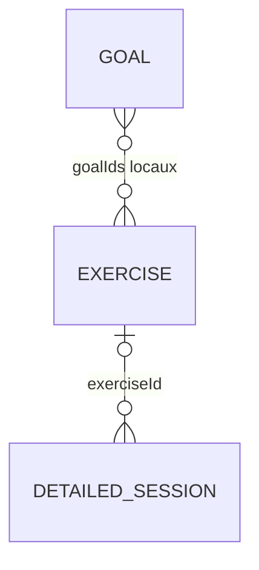
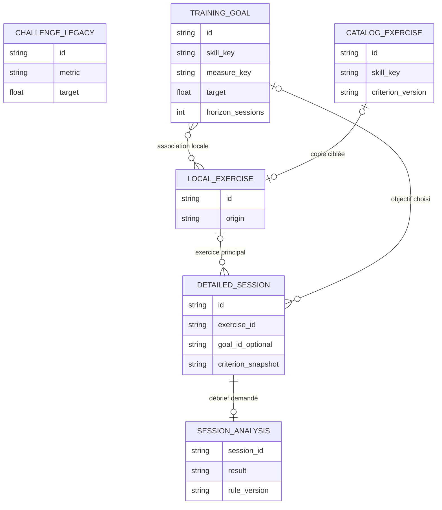

# NT-165 — Cohérence objectifs et exercices pour v0.8.1

Ce document complète [NT-165](../descriptions.md#NT-165) et
[NT-162](../descriptions.md#NT-162). Il fixe le sens produit recherché ; le
dictionnaire de champs, les migrations et les contrats précis devront être
validés dans ces US avant de modifier la persistance.

## État actuel

- `Goal` est un seuil statistique calculé sur toutes les sessions admissibles,
  sans compétence, exercice prescrit ni nombre de tentatives. Plusieurs
  métriques sont des records atteints une fois.
- `Exercise.goalIds` contient des identifiants d'objectifs locaux. Le même
  champ existe dans le contrat du catalogue serveur, alors que le serveur ne
  connaît pas les objectifs personnels de l'utilisateur.
- Une session détaillée porte au plus un `exerciseId`, mais aucun objectif de
  travail sélectionné ni instantané complet des règles de l'exercice.
- Le Coach de session sait déjà débriefer la réalisation et le suivi déclaré
  du protocole. Il ne calcule pas encore la performance selon un critère
  mesurable validé.

## Sens cible

1. Un **exercice** décrit une compétence stable, un protocole, les contraintes
   de réalisation et, si elle existe, une règle versionnée pour mesurer une
   tentative. Le catalogue partagé ne contient aucun ID d'objectif personnel.
2. Un **objectif de travail** décrit l'intention du tireur sur cette
   compétence, une mesure et sa cible, un point de départ éventuel et un
   horizon en nombre de sessions. Il est créé et suivi manuellement dans
   v0.8.1, sans Coach de progression.
3. Une **tentative** est une session réalisée avec un exercice principal et
   son protocole qualifié. Si un objectif de travail a été choisi, la session
   conserve ce lien explicite. Le résultat d'exercice et la progression de
   l'objectif gardent leurs règles propres : réussir une tentative ne valide
   pas automatiquement tout l'objectif.
4. Les **défis personnels** conservent les seuils et records actuels, avec
   leurs données historiques. Ils sont affichés séparément des objectifs de
   travail ; aucune compétence ni tentative ne leur est attribuée par
   migration.

### MCD actuel

### MCD cible de travail

La relation `Goal`–`Exercise` portée dans le catalogue est **supprimée** ;
l'association locale avec `TrainingGoal` est **ajoutée**. `Goal` historique
devient un défi distinct ; la session est **enrichie** d'un objectif facultatif
et de l'instantané de règle. Les cardinalités et champs finaux seront fixés
avec la migration NT-165 et le dictionnaire NT-162.

## Sort des données existantes

| Élément actuel | Décision de cadrage |
|---|---|
| `Goal.id`, titre, description, dates, priorité | Conserver dans les défis historiques, sans réécrire les valeurs. |
| Métrique, comparateur, cible et période `Goal` | Conserver comme règle du défi ; définir séparément les mesures autorisées pour les objectifs de travail. |
| Statut, date d'atteinte, progression, mesures et tendance `Goal` | Conserver comme historique du défi ; ne pas les transformer en preuve d'une tentative. |
| `Exercise.goalIds` personnels | Préserver les associations historiques locales ; déplacer la relation future vers une association propre à l'utilisateur. Ne pas la publier dans le catalogue. |
| `Session.exerciseId` | Conserver ; ajouter seulement les liens et instantanés nécessaires pour les nouvelles tentatives. |
| Exercices et sessions historiques | Rester lisibles sans compétence, règle ou objectif inventé. |

Le mécanisme Hive exact de séparation entre défis et objectifs de travail
reste à choisir après l'inventaire des adapters, imports et sauvegardes. Les
`typeId` et index historiques ne sont jamais réutilisés. Une migration doit
être testée sur des données et sauvegardes antérieures à v0.8.1.

## Propriété et séquence

- **Serveur** : définitions et versions des exercices de catalogue, calcul
  déterministe du résultat d'une tentative analysée, club et adhésions.
- **App** : objectifs et défis personnels, associations locales avec les
  exercices, sessions et brouillons, copie hors ligne d'un exercice demandé
  par ID. Aucun objectif personnel n'est synchronisé en v0.8.1.
- **Contrat** : compétence, mesure, unité, sens d'amélioration et version de
  règle doivent être communs à NT-162, NT-163 et NT-165. Une session analysée
  garde la règle effectivement utilisée même si le catalogue évolue.
- **Ordre** : valider le dictionnaire et les exemples de la bibliothèque avec
  le responsable produit ; fixer le MCD et la migration ; implémenter les
  modèles ; ouvrir la récupération par ID ; réaliser une tentative ; calculer
  et afficher le résultat ; vérifier la progression d'un objectif manuel.

La v0.8.1 n'attribue pas d'exercice ou d'objectif automatiquement et ne crée
pas de plan. Le Coach de session explique seulement la session analysée et
la prochaine action définie par NT-163/NT-164.
